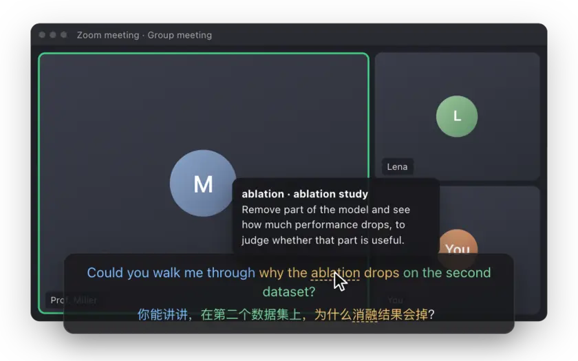
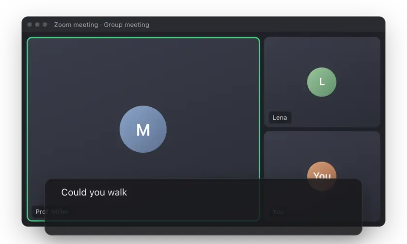
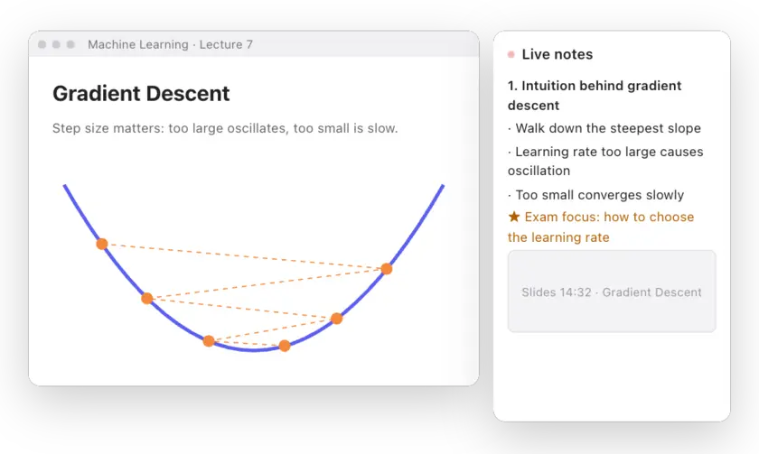
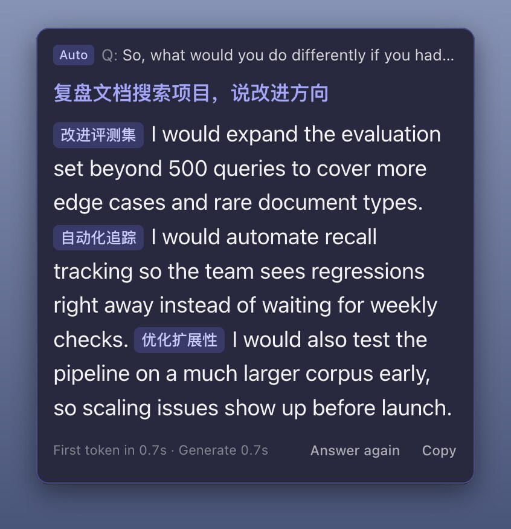
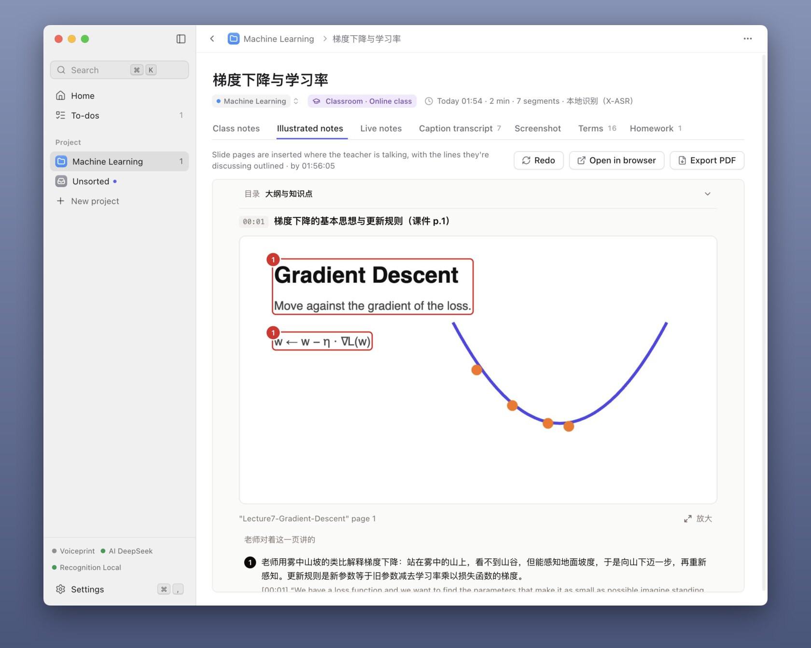

<p align="center"></p>

<h1 align="center">MeetCaption</h1>

<p align="center"><b>Live captions for meetings, interviews and online classes: every sentence the other side says, with your language right below.</b></p>

<p align="center">
<a href="https://github.com/SchaeferAnjon/meetcaption/releases/latest/download/MeetCaption-win-x64.exe"><b>Download for Windows</b></a> ·
<a href="https://github.com/SchaeferAnjon/meetcaption/releases/latest/download/MeetCaption-mac-arm64.dmg"><b>Mac (Apple silicon)</b></a> ·
<a href="https://github.com/SchaeferAnjon/meetcaption/releases/latest/download/MeetCaption-mac-x64.dmg">Mac (Intel)</a>
</p>

<p align="center"><a href="https://meetcaption.us-cloud.uk/?lang=en"></a></p>

<p align="center">
<a href="https://github.com/SchaeferAnjon/meetcaption/releases/latest"></a>
<a href="LICENSE"></a>


</p>

<p align="center"><sub><b>English</b> · <a href="README.zh-CN.md">简体中文</a></sub></p>

<p align="center"></p>

## What it does

Open Zoom, Teams, Tencent Meeting or an online class. The audio from your computer turns into captions that float above every window, each sentence followed by its translation. The other side doesn't need to do anything, and there is no virtual sound card to install.

- **Bilingual captions**: matching phrases share a color; hover over a hard term to see what it means.
- **AI answers**: when someone asks you a question, a reply you can read out appears in the corner.
- **Class notes**: live notes every two minutes, slides captured, illustrated notes after class.
- **Minutes and to-dos**: one click after the meeting; *next Friday* becomes a real date.
- **Knows who is speaking**: a 12-second voiceprint tells you apart from the other side.
- **Hidden when you share**: screen shares, recordings and screenshots show no captions and no answer card.
- **60 languages** for recognition and translation; the app itself comes in 9 languages.
- **Plain files**: every meeting is saved as Markdown in the 会议字幕 folder (the app's Chinese name) inside your Documents folder (you can change it in **Settings**), one folder per project.

## AI answers

<p align="center"></p>

When it hears a question for you, the answer card shows a reply you can read out, with a translation below. If it doesn't appear on its own, press <kbd>⌘</kbd> <kbd>⌥</kbd> <kbd>A</kbd> on Mac or <kbd>Ctrl</kbd> <kbd>Alt</kbd> <kbd>A</kbd> on Windows. When you share your screen, the other side sees no card.

## Class notes

<p align="center"></p>

Pick **In-classroom** (the microphone hears the teacher) or **Online class** (computer audio). Live notes update about every two minutes: outline, formulas, what the teacher stressed, homework and deadlines. After class, **Generate class notes** writes the full notes plus an illustrated version that puts each slide where the teacher talked about it.

## Real screenshots

The app on a Mac, with a synthetic voice playing a sample meeting, interview and lecture. Notes and answers are written in the language you translate into, here Chinese.

<table>
<tr>
<td colspan="2" align="center"><br><sub>Captions on a Mac</sub></td>
</tr>
<tr>
<td width="38%" align="center"><br><sub>Answer card, interview mode</sub></td>
<td align="center"><picture><source media="(prefers-color-scheme: dark)" srcset="docs/readme/en/class-notes-dark.jpg"></picture><br><sub>Illustrated class notes</sub></td>
</tr>
</table>

## Three ways to use it

| | How to start | Cost |
|---|---|---|
| **Free session** | Download and open, nothing to fill in | 1 session of up to 1 hour, cloud recognition and AI included |
| **Your own key** | Paste a key from DeepSeek, Qwen, Kimi, Doubao, Zhipu or OpenAI, or sign in with ChatGPT Plus ([setup guide](https://meetcaption.us-cloud.uk/?lang=en#page=guide), 5 minutes) | **Free forever, no session limit**; you pay your provider |
| **Membership** | No keys; buy sessions in the app or on the [website](https://meetcaption.us-cloud.uk/?lang=en#page=pricing) | From $1.99 per session |

Captions with local recognition are free in every case, no key needed.

<details>
<summary>Session packs</summary>

| | 1 session | 10 sessions | 30 sessions | 100 sessions |
|---|---|---|---|---|
| USD | $1.99 | $15 | $42 | $125 |
| CNY | ¥12.8 | ¥108 | ¥298 | ¥888 |

Sessions never expire and nothing renews. One session is one recording of up to 2 hours. A license code works on up to 2 computers. Unused sessions can be refunded within 14 days.

Prices, the license code and the refund policy are also on the [website](https://meetcaption.us-cloud.uk/?lang=en#page=pricing).

</details>

## Install

| | Download | Needs |
|---|---|---|
| **Windows** | [`MeetCaption-win-x64.exe`](https://github.com/SchaeferAnjon/meetcaption/releases/latest/download/MeetCaption-win-x64.exe) | Windows 10 or 11 |
| **Mac with Apple silicon** (M1 to M4) | [`MeetCaption-mac-arm64.dmg`](https://github.com/SchaeferAnjon/meetcaption/releases/latest/download/MeetCaption-mac-arm64.dmg) | macOS 14.2 or later |
| **Mac with an Intel chip** | [`MeetCaption-mac-x64.dmg`](https://github.com/SchaeferAnjon/meetcaption/releases/latest/download/MeetCaption-mac-x64.dmg) | macOS 14.2 or later |

The [website](https://meetcaption.us-cloud.uk/?lang=en) has the same downloads, plus setup guides in 9 languages. Earlier versions are on the [releases page](https://github.com/SchaeferAnjon/meetcaption/releases).

<details>
<summary>The first time you open it</summary>

- **Mac**: if macOS says the developer cannot be verified, open **System Settings**, go to **Privacy & Security**, scroll to the bottom and click **Open Anyway**.
- **Windows**: if **Windows protected your PC** appears, click **More info**, then **Run anyway**.
- A setup window asks for the microphone and, on Mac, system audio: drag the rabbit icon into the **System Audio Recording Only** list.
- After that MeetCaption updates itself, and never restarts while you are recording.

</details>

<details>
<summary>Shortcuts</summary>

| | Mac | Windows |
|---|---|---|
| Start or stop recording | <kbd>⌘</kbd> <kbd>⌥</kbd> <kbd>R</kbd> | <kbd>Ctrl</kbd> <kbd>Alt</kbd> <kbd>R</kbd> |
| Show or hide captions and the answer card | <kbd>⌘</kbd> <kbd>⌥</kbd> <kbd>S</kbd> | <kbd>Ctrl</kbd> <kbd>Alt</kbd> <kbd>S</kbd> |
| Answer the last question | <kbd>⌘</kbd> <kbd>⌥</kbd> <kbd>A</kbd> | <kbd>Ctrl</kbd> <kbd>Alt</kbd> <kbd>A</kbd> |
| Capture the current slide in class | <kbd>⌘</kbd> <kbd>⌥</kbd> <kbd>P</kbd> | <kbd>Ctrl</kbd> <kbd>Alt</kbd> <kbd>P</kbd> |

Every shortcut can be changed in **Settings**, page **Shortcuts**.

</details>

<details>
<summary>All 60 languages</summary>

English, Chinese, Japanese, Korean, German, French, Spanish, Italian, Portuguese, Russian, Afrikaans, Albanian, Arabic, Azerbaijani, Basque, Belarusian, Bangla, Bosnian, Bulgarian, Catalan, Croatian, Czech, Danish, Dutch, Estonian, Finnish, Galician, Greek, Gujarati, Hebrew, Hindi, Hungarian, Indonesian, Kannada, Kazakh, Latvian, Lithuanian, Macedonian, Malay, Malayalam, Marathi, Norwegian, Persian, Polish, Punjabi, Romanian, Serbian, Slovak, Slovenian, Swahili, Swedish, Filipino, Tamil, Telugu, Thai, Turkish, Ukrainian, Urdu, Vietnamese, Welsh. Captions can also be translated into Traditional Chinese.

Local recognition (free, offline) understands Chinese, English and a mix of both; other languages use cloud recognition. The interface comes in 简体中文, 繁體中文, English, 日本語, 한국어, Deutsch, Français, Español and Italiano.

</details>

## Privacy

- No account, no sign-up.
- With local recognition, audio never leaves your computer.
- With membership cloud recognition, audio goes from your computer straight to Soniox; our server only hands out a one-time key.
- Sentences to translate or answer go to the AI service you choose: straight to your provider with your own key, or through our server with membership, not stored.
- Your voiceprint, recordings, notes and keys stay on your computer.
- Anonymous usage statistics, only if you agree: once a day the app tells our server a random ID, the version, the operating system and chip, membership or your own key, and the interface language. No meeting content, keys, names or email. Without your consent nothing is sent; switch it on or off any time in **Settings**, page **General**, **Anonymous usage statistics**.

## Build from source

```bash
npm install
npm run models   # local recognition model, 170 MB, not in git
npm start
```

Tests, releases, self-tests and the code layout: [docs/DEVELOPMENT.md](docs/DEVELOPMENT.md).

## License

[GPL-3.0-or-later](LICENSE). Licenses of the bundled models and native libraries are in [NOTICE.txt](resources/models/NOTICE.txt).
