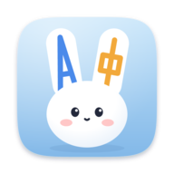
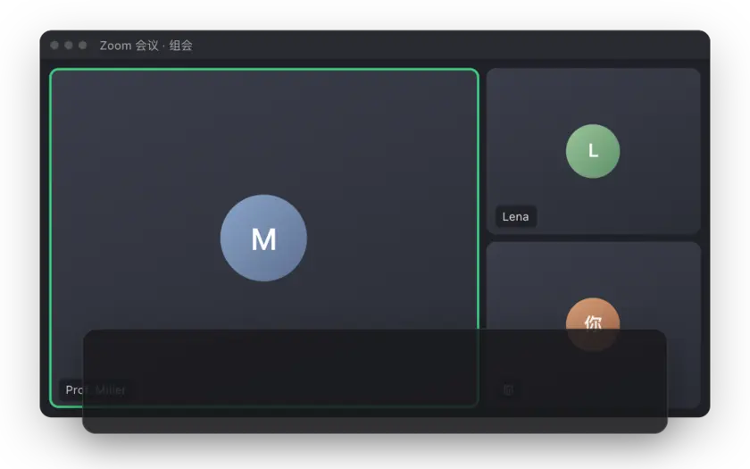
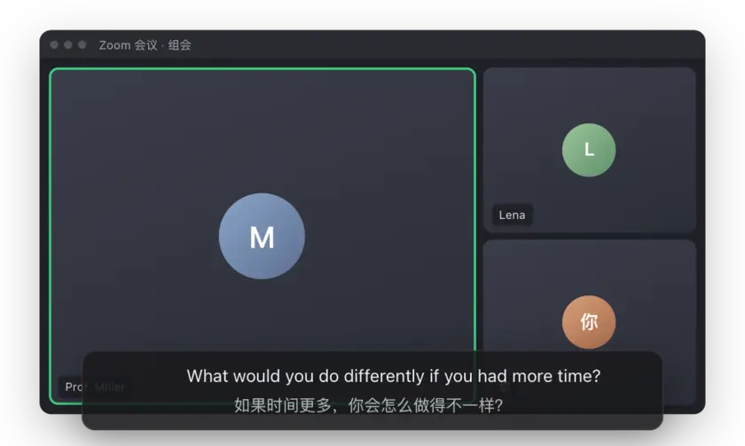
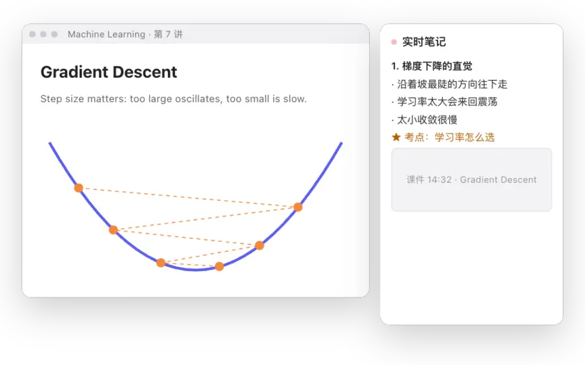
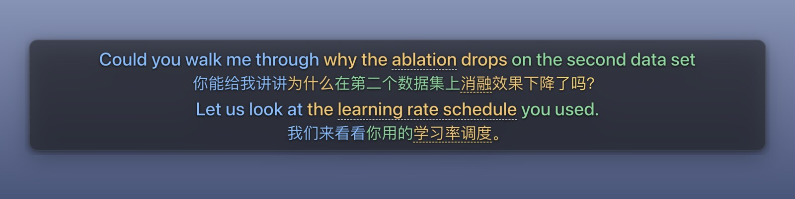
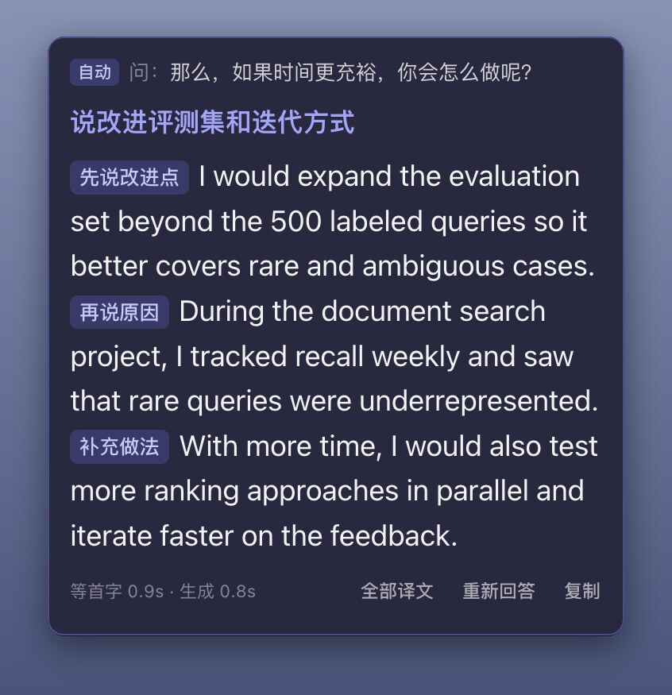
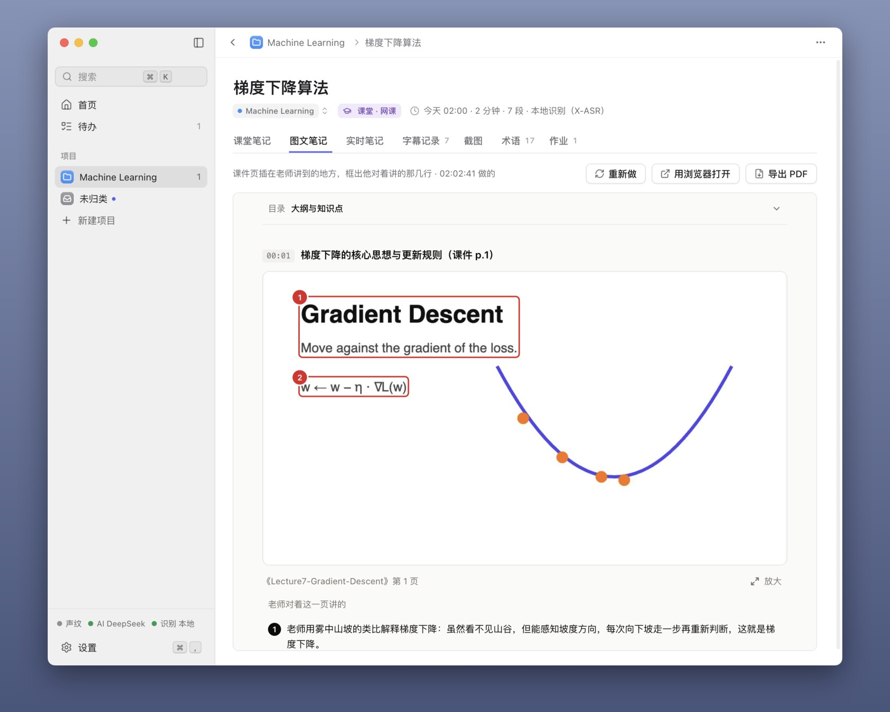

<p align="center"></p>

<h1 align="center">MeetCaption</h1>

<p align="center"><b>会议、面试、网课的实时双语字幕：对方说的每一句，中文就在下面。</b></p>

<p align="center">
<a href="https://github.com/SchaeferAnjon/meetcaption/releases/latest/download/MeetCaption-win-x64.exe"><b>下载 Windows 版</b></a> ·
<a href="https://github.com/SchaeferAnjon/meetcaption/releases/latest/download/MeetCaption-mac-arm64.dmg"><b>Mac 版（Apple 芯片）</b></a> ·
<a href="https://github.com/SchaeferAnjon/meetcaption/releases/latest/download/MeetCaption-mac-x64.dmg">Mac 版（Intel 芯片）</a>
</p>

<p align="center"><a href="https://meetcaption.us-cloud.uk/?lang=zh"></a></p>

<p align="center">
<a href="https://github.com/SchaeferAnjon/meetcaption/releases/latest"></a>
<a href="LICENSE"></a>


</p>

<p align="center"><sub><a href="README.md">English</a> · <b>简体中文</b></sub></p>

<p align="center"></p>

## 它做什么

开 Zoom、Teams、腾讯会议或者上网课，电脑里放出来的声音实时变成字幕，浮在所有窗口最上层，每句下面跟一句译文。不用对方做任何事，也不用装虚拟声卡。

- **双语字幕**：意思对应的片段同一种颜色，难词鼠标停上去就有解释。
- **AI 答题**：对方一问完，屏幕角上给出能照着说的回答。
- **课堂笔记**：每两分钟整理一版实时笔记，截下课件，下课生成图文并茂的课堂笔记。
- **纪要和待办**：会开完一键整理，*下周五* 会换算成具体日期。
- **分得清是谁在说**：录 12 秒声纹，就能分清你和对方。
- **共享屏幕时隐藏**：共享屏幕、录屏、截图里都没有字幕和答题框。
- **60 种语言**的识别和翻译，软件界面有 9 种语言。
- **都是普通文件**：每场会议存成 Markdown，放在文稿文件夹里的 会议字幕 文件夹（可以在 **设置** 里改），一个项目一个文件夹。

## AI 答题

<p align="center"></p>

听出是在问你，答题框马上给出能照着说的回答，下面带译文。没自动出来就按 <kbd>⌘</kbd> <kbd>⌥</kbd> <kbd>A</kbd>（Windows 上 <kbd>Ctrl</kbd> <kbd>Alt</kbd> <kbd>A</kbd>）。共享屏幕时，对方看不到答题框。

## 课堂笔记

<p align="center"></p>

先选 **教室现场**（用麦克风听老师）还是 **网课**（听电脑里的声音）。实时笔记大约每两分钟更新一次：小节大纲、公式、老师强调的考点、作业和截止时间。下课点 **生成课堂笔记**，得到完整笔记，还有一份图文版，课件插在老师讲到它的地方。

## 真机截图

Mac 上的真实窗口，用合成的人声放一段示例会议、面试和讲课。

<table>
<tr>
<td colspan="2" align="center"><br><sub>Mac 上的字幕</sub></td>
</tr>
<tr>
<td width="38%" align="center"><br><sub>答题框，面试模式</sub></td>
<td align="center"><picture><source media="(prefers-color-scheme: dark)" srcset="docs/readme/zh/class-notes-dark.jpg"></picture><br><sub>图文课堂笔记</sub></td>
</tr>
</table>

## 三种用法

| | 怎么开始 | 费用 |
|---|---|---|
| **送的 1 场** | 下载打开就能用，什么都不用填 | 1 场，最长 1 小时，云识别和 AI 都包含 |
| **自带 Key** | 填 DeepSeek、通义、Kimi、豆包、智谱或 OpenAI 的 Key，有 ChatGPT Plus 可以直接登录（[配置教程](https://meetcaption.us-cloud.uk/?lang=zh#page=guide)，5 分钟） | **永久免费，不限场次**；费用直接付给服务商 |
| **会员** | 不用配 Key，在应用里或[官网](https://meetcaption.us-cloud.uk/?lang=zh#page=pricing)按场买 | ¥12.8 一场起 |

用本地识别出字幕，哪种用法都免费，不用 Key。

<details>
<summary>会员场次价格</summary>

| | 1 场 | 10 场 | 30 场 | 100 场 |
|---|---|---|---|---|
| 人民币 | ¥12.8 | ¥108 | ¥298 | ¥888 |
| 美元 | $1.99 | $15 | $42 | $125 |

场次不过期，不自动续费。一场就是一次记录，最长 2 小时。一个授权码最多用在 2 台电脑上。没用过的场次购买后 14 天内可以退款。

价格、授权码和退款说明在[官网](https://meetcaption.us-cloud.uk/?lang=zh#page=pricing)上也有。

</details>

## 安装

| | 下载 | 系统 |
|---|---|---|
| **Windows** | [`MeetCaption-win-x64.exe`](https://github.com/SchaeferAnjon/meetcaption/releases/latest/download/MeetCaption-win-x64.exe) | Windows 10 或 11 |
| **Apple 芯片的 Mac**（M1 到 M4） | [`MeetCaption-mac-arm64.dmg`](https://github.com/SchaeferAnjon/meetcaption/releases/latest/download/MeetCaption-mac-arm64.dmg) | macOS 14.2 或更新 |
| **Intel 芯片的 Mac** | [`MeetCaption-mac-x64.dmg`](https://github.com/SchaeferAnjon/meetcaption/releases/latest/download/MeetCaption-mac-x64.dmg) | macOS 14.2 或更新 |

[官网](https://meetcaption.us-cloud.uk/?lang=zh)上有同样的下载，还有 9 种语言的使用教程。旧版本在 [Releases 页面](https://github.com/SchaeferAnjon/meetcaption/releases)。

<details>
<summary>第一次打开</summary>

- **Mac**：提示无法验证开发者时，打开 **系统设置** 里的 **隐私与安全性**，拉到最下面点 **仍要打开**。
- **Windows**：弹出 **Windows 已保护你的电脑** 时，先点 **更多信息**，再点 **仍要运行**。
- 引导窗口要两个权限：麦克风，以及 Mac 上的系统录音，把兔子图标拖进 **仅系统录音** 列表就行。
- 装好以后会自动更新，正在记录时不会重启。

</details>

<details>
<summary>快捷键</summary>

| | Mac | Windows |
|---|---|---|
| 开始或停止记录 | <kbd>⌘</kbd> <kbd>⌥</kbd> <kbd>R</kbd> | <kbd>Ctrl</kbd> <kbd>Alt</kbd> <kbd>R</kbd> |
| 显示或隐藏字幕和答题框 | <kbd>⌘</kbd> <kbd>⌥</kbd> <kbd>S</kbd> | <kbd>Ctrl</kbd> <kbd>Alt</kbd> <kbd>S</kbd> |
| 回答刚才的问题 | <kbd>⌘</kbd> <kbd>⌥</kbd> <kbd>A</kbd> | <kbd>Ctrl</kbd> <kbd>Alt</kbd> <kbd>A</kbd> |
| 上课时截下当前课件 | <kbd>⌘</kbd> <kbd>⌥</kbd> <kbd>P</kbd> | <kbd>Ctrl</kbd> <kbd>Alt</kbd> <kbd>P</kbd> |

所有快捷键都能在 **设置** 的 **快捷键** 里改。

</details>

<details>
<summary>全部 60 种语言</summary>

英语、中文、日语、韩语、德语、法语、西班牙语、意大利语、葡萄牙语、俄语、南非荷兰语、阿尔巴尼亚语、阿拉伯语、阿塞拜疆语、巴斯克语、白俄罗斯语、孟加拉语、波斯尼亚语、保加利亚语、加泰罗尼亚语、克罗地亚语、捷克语、丹麦语、荷兰语、爱沙尼亚语、芬兰语、加利西亚语、希腊语、古吉拉特语、希伯来语、印地语、匈牙利语、印度尼西亚语、卡纳达语、哈萨克语、拉脱维亚语、立陶宛语、马其顿语、马来语、马拉雅拉姆语、马拉地语、挪威语、波斯语、波兰语、旁遮普语、罗马尼亚语、塞尔维亚语、斯洛伐克语、斯洛文尼亚语、斯瓦希里语、瑞典语、菲律宾语、泰米尔语、泰卢固语、泰语、土耳其语、乌克兰语、乌尔都语、越南语、威尔士语。字幕还能翻成繁体中文。

本地识别（免费、不联网）认中文、英文和中英夹杂，其他语言用云识别。软件界面有简体中文、繁體中文、English、日本語、한국어、Deutsch、Français、Español、Italiano。

</details>

## 隐私

- 不用注册，没有账号。
- 用本地识别时，声音不出你的电脑。
- 会员的云识别：声音从你的电脑直接发给 Soniox，我们的服务器只发一把一次性的临时 Key。
- 要翻译、要回答的句子发给你选的 AI 服务：自带 Key 时直接发给服务商，会员经我们的服务器转发，处理完不保存。
- 声纹、记录、笔记和你填的 Key 都只在你的电脑上。
- 匿名使用统计，你同意了才发：软件每天告诉我们的服务器一次：随机编号、版本号、系统和芯片、用会员还是自带 Key、界面语言，用来统计每天有多少人在用，不含会议内容、Key、名字或邮箱。没同意就什么都不发；在 **设置** 的 **通用** 里随时能打开或关掉 **匿名使用统计**。

## 从源码构建

```bash
npm install
npm run models   # 下载本地识别模型，170 MB，不在 git 里
npm start
```

测试、发版、自测和代码结构见 [docs/DEVELOPMENT.md](docs/DEVELOPMENT.md)（英文）。

## 许可证

[GPL-3.0-or-later](LICENSE)。随安装包分发的模型和原生库的许可证见 [NOTICE.txt](resources/models/NOTICE.txt)。
