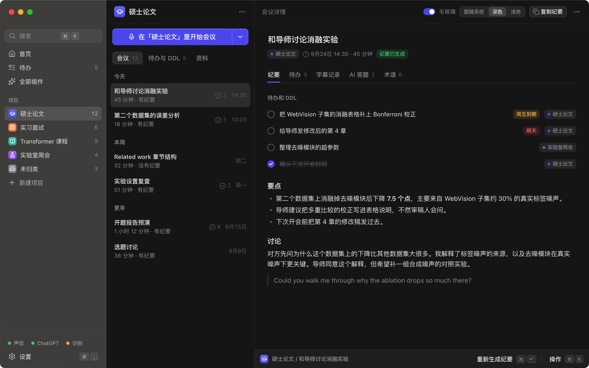
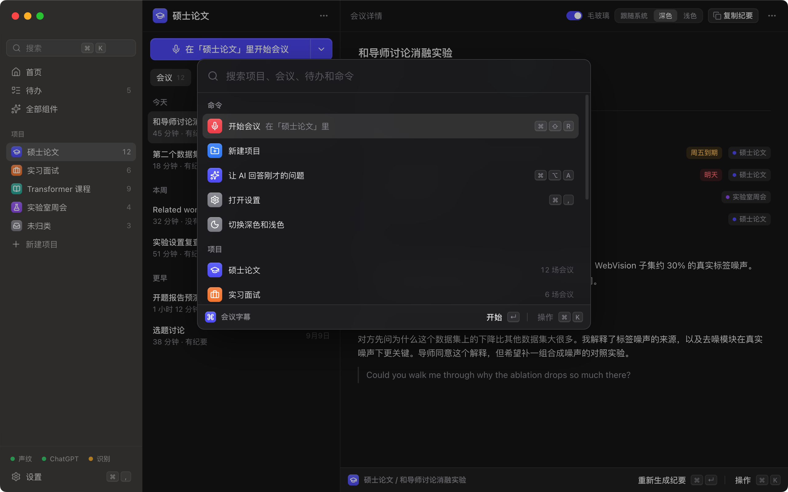
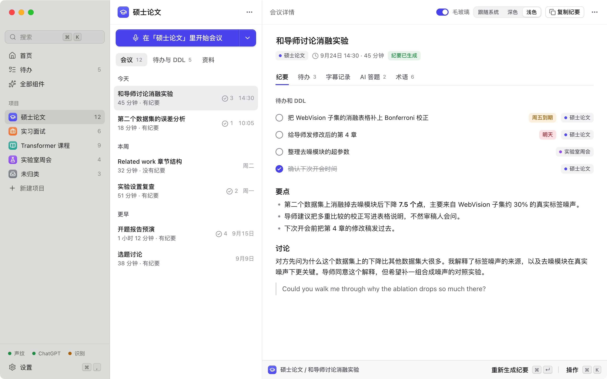
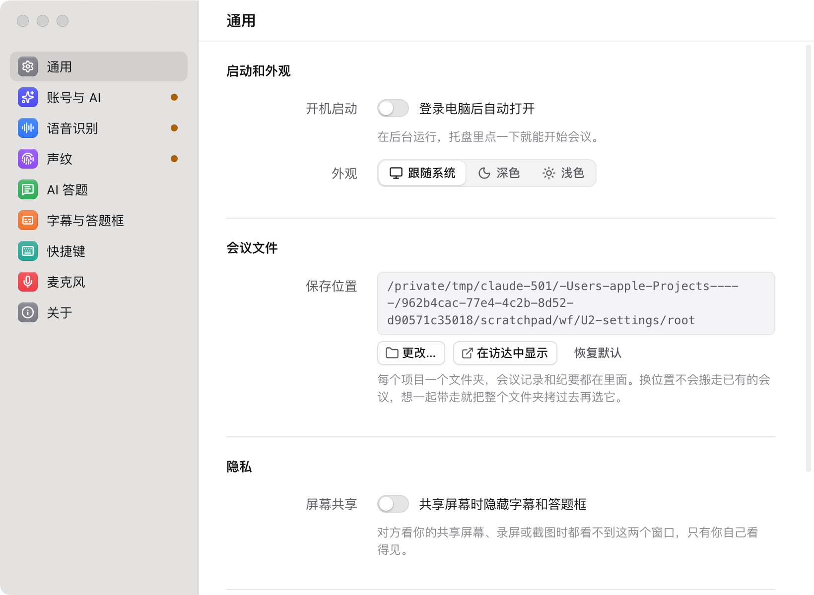

# 会议字幕 v3 进度截图（2026-09-24 17:25）

设计系统（Raycast 风格组件库）已完成，下面 1 到 3 是组件库的展示页，用示例数据拼出主窗口骨架；主窗口正式页面还在做。4 是设置窗口的半成品。

## 1. 主窗口骨架（深色）

左侧栏：搜索（⌘K）、首页、待办、项目列表、底部状态小条（声纹 / ChatGPT / 识别）和设置。中间：当前项目的会议列表，顶部「在「硕士论文」里开始会议」。右边：会议详情，纪要里的待办带截止日期和归属项目。

## 2. 命令面板（⌘K）

开始会议、新建项目、让 AI 回答、打开设置、切换项目、搜索会议和待办。

## 3. 主窗口骨架（浅色）

## 4. 设置窗口（做到一半）

左侧分区，右侧「左标签、右控件」的行；黄点表示这一项还没配好。

