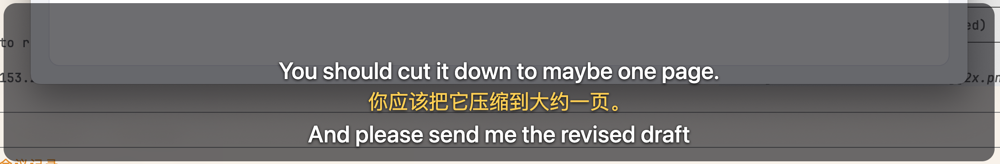
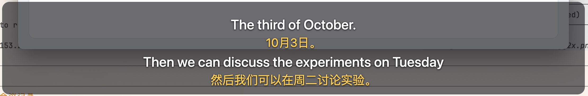
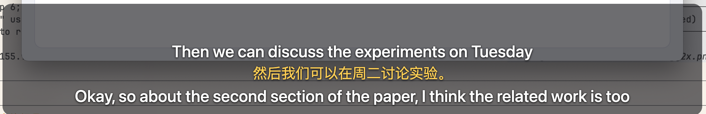
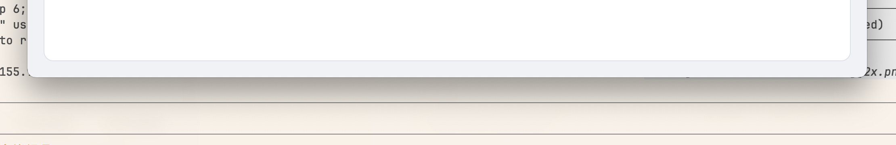
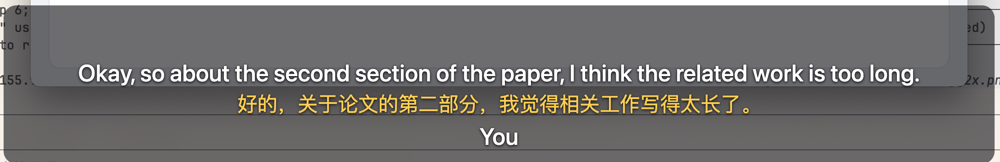
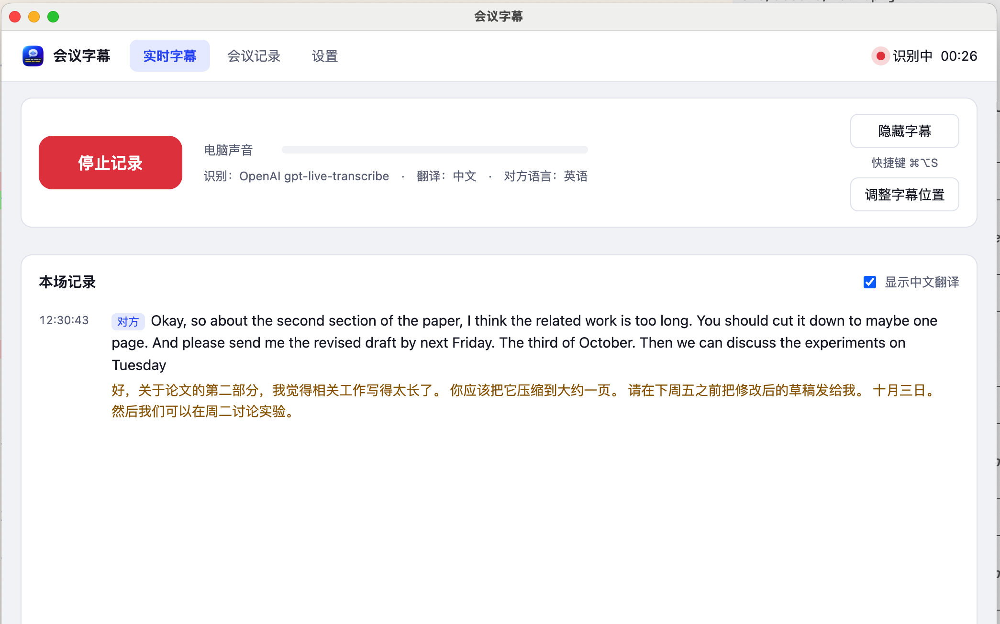
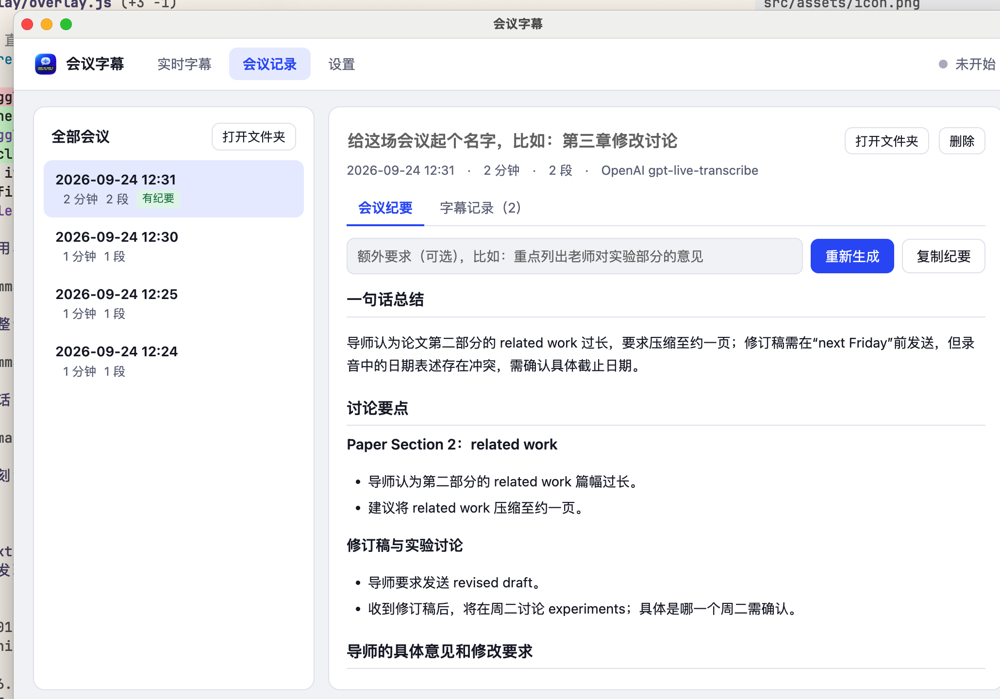
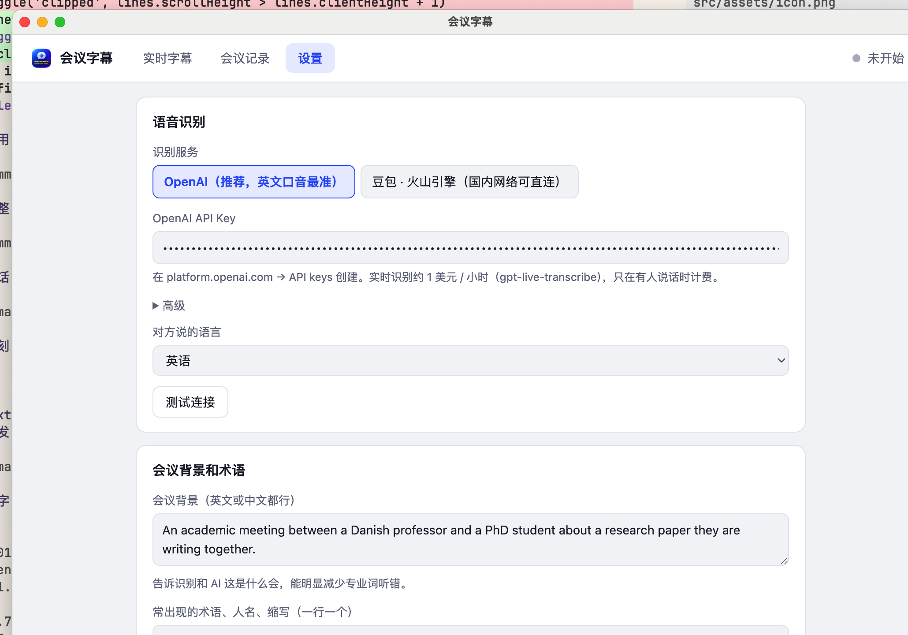
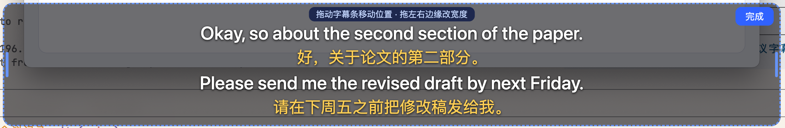
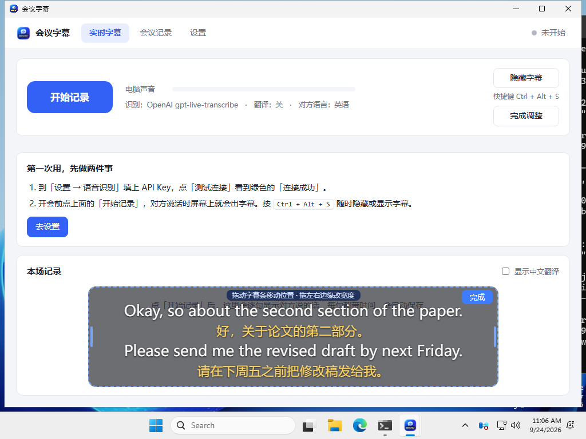

# 会议字幕 实测截图（2026-09-24）

测试方式：Mac mini 上用系统 TTS（Daniel 英音）生成一段 15 秒的「导师说话」音频，用 afplay 从扬声器放出来，应用抓系统声音实时识别。识别用 OpenAI gpt-live-transcribe，翻译 gpt-5.6-luna，纪要 gpt-5.6-terra。

测试音频原文：Okay, so about the second section of the paper. I think the related work is too long, you should cut it down to maybe one page. And please send me the revised draft by next Friday, the third of October. Then we can discuss the experiments on Tuesday.

## 1. 说话过程中的字幕

说到一半时，已说完的句子带中文翻译，正在说的句子只有英文，比说话晚约 1 秒。

## 2. 整句双语

每句英文下面紧跟它的中文，放不下时最上面的整句移走，不会出现半行。

## 3. 快捷键隐藏 / 显示（⌘⌥S）

3a 正在显示，3b 按一下后 0.3 秒截图已经消失，3c 再按一下立刻回来。

## 4. 主窗口：实时记录

## 5. 会后生成的会议纪要

AI 把「next Friday」换算成了 2026-10-02，还发现测试音频里「周五」和「10 月 3 日（其实是周六）」对不上，标成待确认。

## 6. 设置

## 7. 调整字幕位置

拖动字幕条移动，拖左右两边的蓝色把手改宽度，点「完成」。

## 8. Windows

GitHub Actions 的 Windows 机器上装 VB-CABLE 虚拟声卡，用系统 TTS 播一段英文，打包好的 MeetCaption.exe 在 14 秒里抓到 13.9 秒音频，78 包是语音（最大电平 -11.5 dB）。下面是 CI 里打开的 Windows 界面（字幕窗在调整位置模式，显示示例字幕）。

